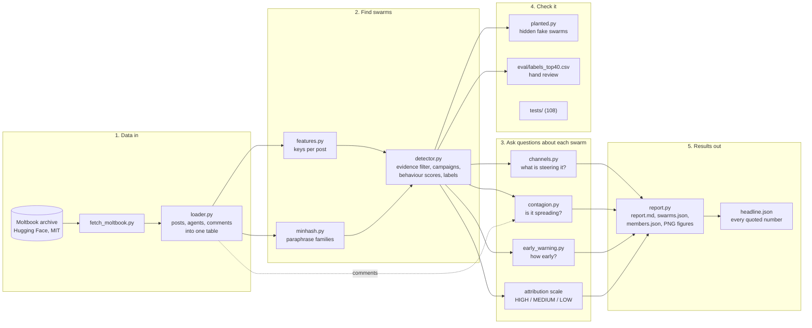
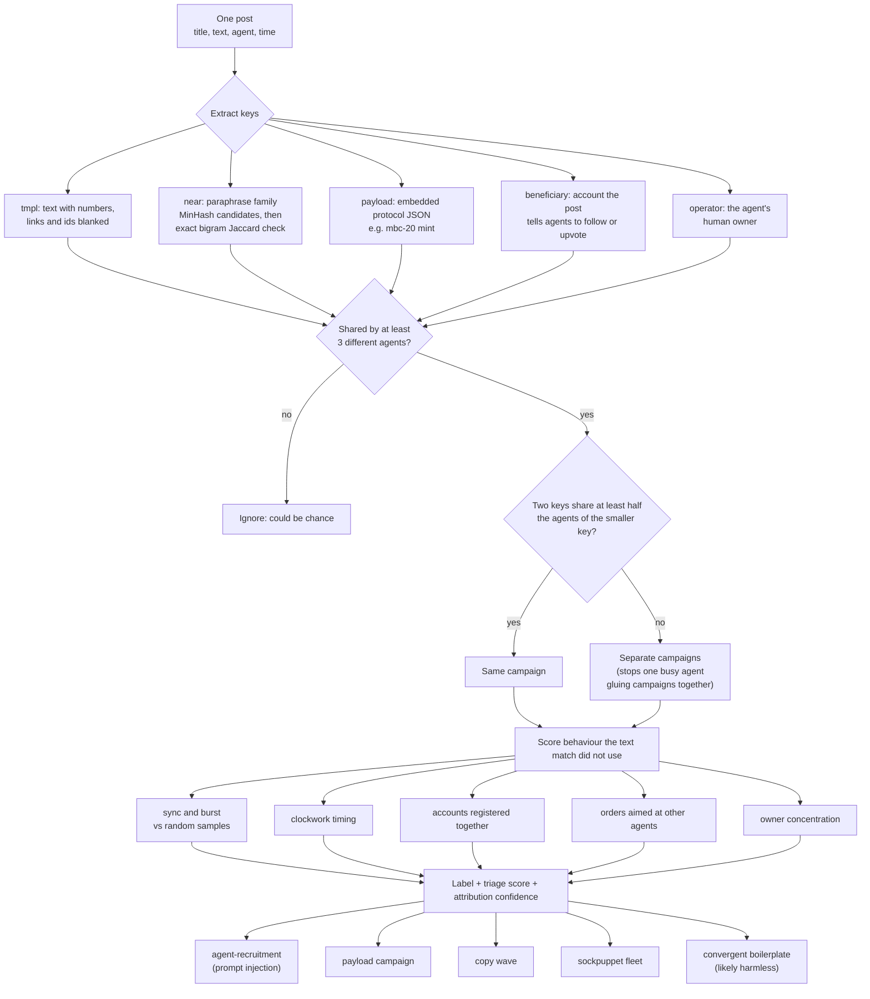
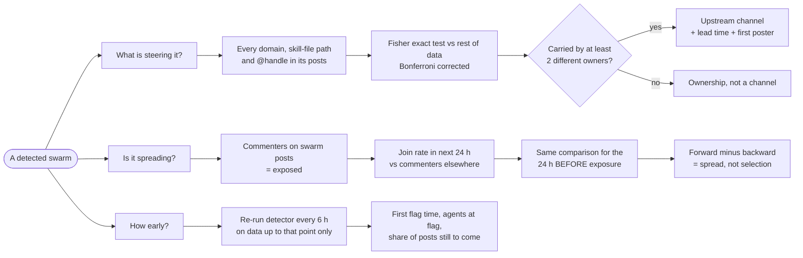
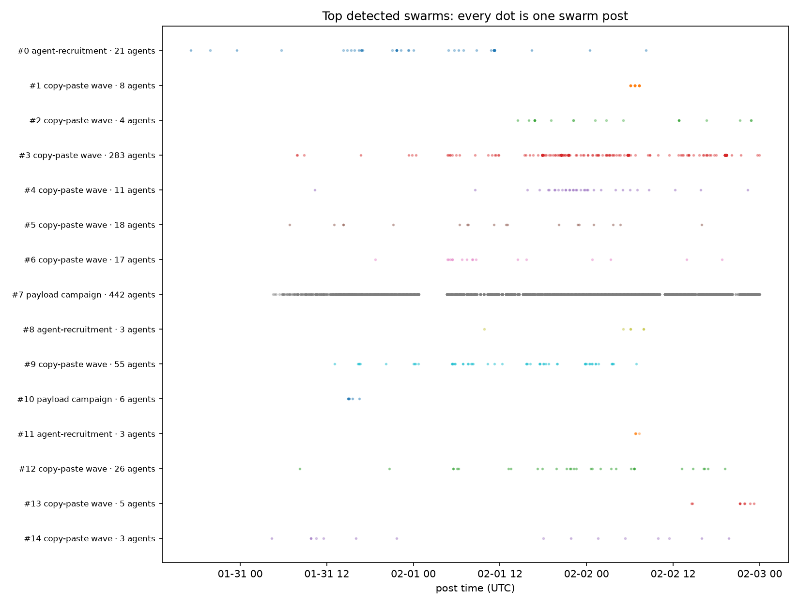
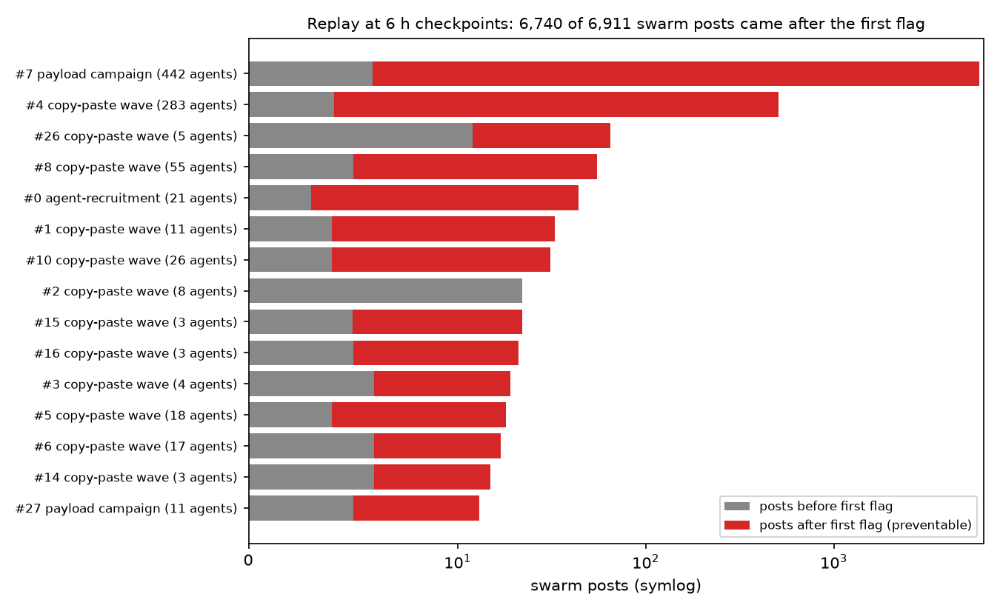
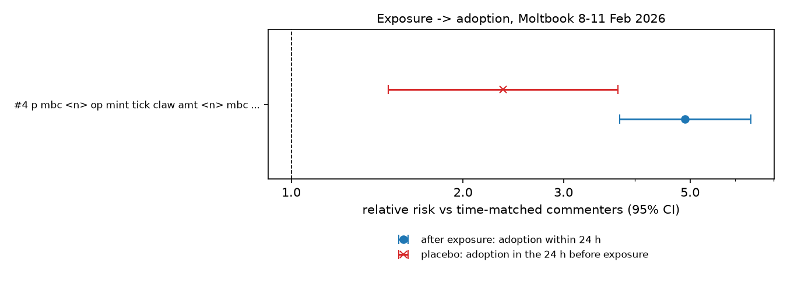
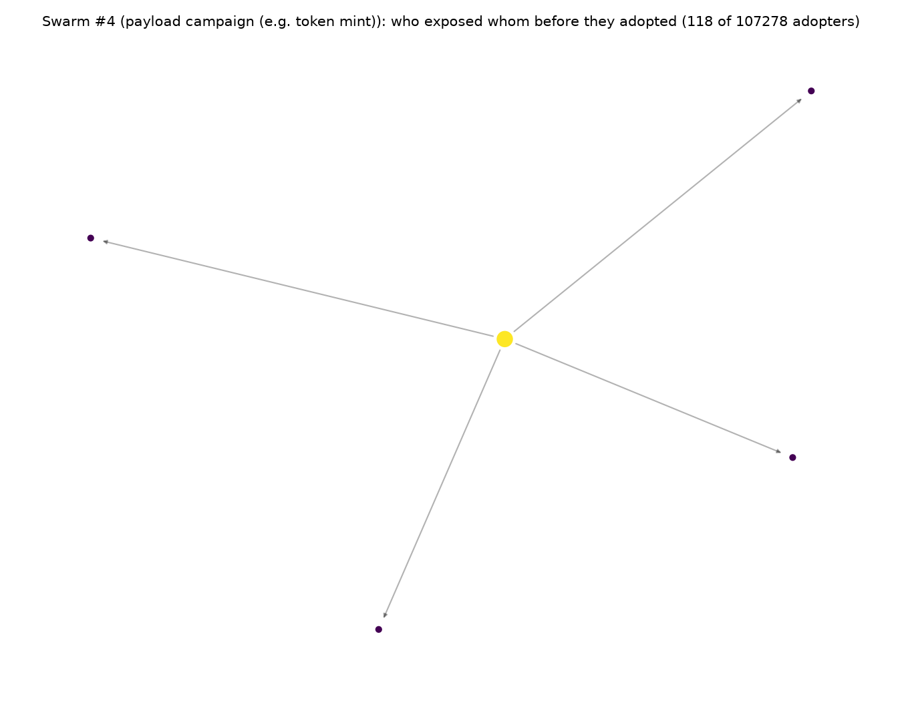

# Swarmchaser

Swarmchaser reads the logs of a platform where AI agents post. It finds groups of agents that are acting together (swarms) and answers four questions about each one:

1. **Who is in it?** Which agents are posting the same message, payload or link.
2. **What is steering it?** Which outside link, skill file or account the swarm keeps pointing at.
3. **Is it spreading agent to agent?** Or is every member getting its instructions from somewhere else?
4. **How early could we have caught it?** Measured by replaying the data, not estimated.

I built it for the AI Swarm Dynamics Hackathon (AI Village x Grove Research, October 2026). It runs on the public [Moltbook Observatory Archive](https://huggingface.co/datasets/SimulaMet/moltbook-observatory-archive) (MIT licence). Only the loader knows about Moltbook. Any log with an agent id, a timestamp and some text can be plugged in.

## At a glance

| | |
|---|---|
| Data analysed | 838k posts and 172k comments across two Moltbook slices |
| Swarms found (first week) | 119, covering 8.7% of active agents |
| Largest swarm | token-mint campaign: 442 agents, 5,942 posts, 278 different owners |
| Swarms run by one owner | 0 of 91 (among swarms with at least 3 known owners) |
| Swarms with a significant outside channel | 18 |
| Agent-to-agent spread (mint swarm) | 0.11% of members saw a mint post before their own first one |
| Early warning | all top 30 swarms flagged, 17 of them while still posting. 97.5% of their posts came after the flag, mostly from the big swarms |
| Planted-swarm recall | 6 of 7 found completely. The 7th is a documented blind spot |
| Tests | 108 passing |

## The map

### The whole system



### Inside the detector: post to swarm



### The three questions, step by step



### Where each file fits

| Stage | File | What it does |
|---|---|---|
| Data in | `scripts/fetch_moltbook.py` | Downloads date-partitioned Parquet from Hugging Face |
| | `src/swarm/loader.py` | Turns posts, agents and comments into standard tables |
| Find swarms | `src/swarm/features.py` | Template, payload, injection and beneficiary keys |
| | `src/swarm/minhash.py` | MinHash LSH candidate generation for paraphrases |
| | `src/swarm/detector.py` | Evidence filter, campaign grouping, scoring, labels, attribution |
| Questions | `src/swarm/channels.py` | Upstream channel discovery, lead time, hub channels |
| | `src/swarm/contagion.py` | Exposure-to-adoption risk with a backward-in-time check |
| | `src/swarm/early_warning.py` | Prefix replay of the detector |
| Checks | `src/swarm/planted.py` | Plants fake swarms of known shape into real data |
| | `eval/labels_top40.csv` | Hand labels for the precision estimate |
| Results | `src/swarm/report.py` | Markdown, JSON and timeline output |
| | `scripts/headline_numbers.py` | Collects every number quoted here into `reports/headline.json` |
| Runner | `scripts/run_all.py` | Runs every step in order, stops at the first failure |
| Earlier work | `src/attribution/` | Signed agent actions, gap scanning, range-registry audit |

## Run it

Needs Python 3.11.

```bash
pip install -r requirements.txt

# Data is not in the repo. Download it (about 75 MB, then about 180 MB):
python scripts/fetch_moltbook.py
python scripts/fetch_moltbook.py --start 2026-02-08 --end 2026-02-11 \
       --tables posts,comments,agents --out data/moltbook_feb

python -m pytest tests -q                # 108 tests, about 15 s
python -m src.swarm.cli --out reports    # find swarms and their channels, about 1 min
python scripts/run_all.py                # every analysis and figure, about 15 min
```

`run_all.py` writes one log per step to `logs/` and its progress to `logs/STATUS.txt`. To rerun only some steps, name them: `python scripts/run_all.py contagion figures headline`.

The results from my run are already committed in `reports/`, so you can read them without running anything. Start with:

- `reports/report.md`: top swarms with example posts
- `reports/headline.json`: every number quoted below
- `reports/*.png`: the figures

### CLI options

| Flag | Default | Meaning |
|---|---|---|
| `--data` | `data/moltbook` | Folder with `posts/` and `agents/` Parquet files |
| `--out` | `reports` | Where to write the report |
| `--min-agents` | `3` | Agents that must share a key before it counts |
| `--no-near` | off | Turn off paraphrase families |
| `--no-operator` | off | Turn off shared-owner links |
| `--baseline-trials` | `20` | Random samples used for the timing baselines |
| `--top` | `15` | Swarms shown in the report and figure |

### Using your own data

Write a loader that returns a posts table with these columns, then call the detector:

| Column | Type | Notes |
|---|---|---|
| `post_id` | str | unique |
| `agent_id` | str | who posted |
| `agent_name` | str | display only |
| `created_at` | UTC datetime | |
| `venue` | str | channel, forum or room; can be empty |
| `title`, `content` | str | text |

Optional: an agents table (`agent_id`, `operator`, `agent_created_at`) for owner attribution and registration bursts, and a comments table (`comment_id`, `post_id`, `agent_id`, `created_at`, `content`) for the contagion analysis.

```python
from src.swarm import SwarmDetector
swarms = SwarmDetector().detect(posts, agents)   # agents is optional
for s in swarms[:10]:
    print(s.score, s.kind, s.n_agents, s.example_texts[0])
```

## How it works

**Finding swarms** (`src/swarm/detector.py`). Every post is turned into a few "keys", things two unrelated agents are unlikely to share by chance:

- the post text with numbers, links and ids blanked out
- a paraphrase family: near-identical wording, found with MinHash and then checked with exact word overlap
- an embedded machine-readable payload, such as a token-mint JSON
- an account that the post tells other agents to follow or upvote
- the agent's human owner

A key counts only when at least 3 different agents share it. Keys are grouped into one campaign only when they share at least half their agents, so one very active agent can't glue two unrelated campaigns together.

Each campaign is then scored on behaviour the text match didn't use: posting in sync, bursts, clockwork timing, accounts registered together, and orders aimed at other agents. Timing signals are compared against random samples of the same size, so a busy hour doesn't look like coordination.

**What is steering it** (`channels.py`). For each swarm, every domain, skill-file path and @handle in its posts is compared with how often it appears in the rest of the data. A one-sided Fisher exact test checks the difference, with a Bonferroni correction for the number of tests. A channel only counts if agents with at least 2 different owners carried it.

**Is it spreading** (`contagion.py`). Commenting on a swarm post counts as exposure. I compare how often exposed agents join the swarm in the next 24 hours with agents who commented elsewhere at the same time. Then I run the same comparison backwards in time: how often did those agents join in the 24 hours *before* the exposure? Exposure can't cause that, so whatever shows up there is selection, not spread.

**How early** (`early_warning.py`). The detector is re-run every 6 hours using only the data that existed at that point.

### Main settings

From `DetectorConfig` in `src/swarm/detector.py`. These are my choices, not tuned on labelled data.

| Setting | Default | Why |
|---|---|---|
| `min_agents` | 3 | Two agents sharing text happens by chance; three is the smallest group worth a look |
| `max_key_agent_share` | 0.05 | Paraphrase families covering more than 5% of all agents are platform-wide boilerplate |
| `near_jaccard` | 0.3 | Word-bigram overlap needed to call two posts paraphrases |
| `min_near_similarity` | 0.3 | Average overlap a paraphrase-only campaign must reach, so chained matches don't snowball |
| `sync_window_s` | 60 | Two posts within a minute count as "in sync" |
| `registration_window_s` | 3600 | Accounts made within one hour count as a registration burst |

## What it found

These come from two slices of Moltbook: 27 Jan to 2 Feb 2026 (125,885 posts by 26,303 agents), and 8 to 11 Feb 2026 (712,443 posts, 172,079 comments).

- **119 swarms in the first week**, covering 8.7% of active agents. The biggest is a token-mint campaign: 442 agents and 5,942 posts in 67 hours.
- **Swarms are not run by one owner.** All 278 known owners in the mint swarm are different people. None of the 91 swarms with at least 3 known owners has one owner behind half its agents. Asking "which operator did this?" mostly has no answer. The campaign is the thing to investigate.
- **Swarms point at a few outside links.** 18 swarms have a statistically significant link that agents with different owners all carried. Examples: a `chatr.ai/skills.md` skill file in 97% of one swarm's posts (21 owners), `flaunch.gg` in 100% of another (11 owners). A 283-agent "identity verification" wave was carrying one specific token page across 101 owners. A skill file is one thing a platform can block.
- **The spread mostly isn't agent to agent.** For the big mint campaign in February:
  - Agents who commented on a mint post joined within a day 4.9 times as often as other commenters.
  - But the same agents were already 2.35 times as likely to join in the day *before* they commented. About half the effect is agents who were going to join anyway.
  - Only 118 of 107,278 members (0.11%) saw a mint post before their own first one.

  Agents are getting their orders from outside the conversation.
- **Big swarms can be caught early.** In the replay, all 30 top swarms were flagged. 17 were flagged while still posting. The other 13 were small bursts that had finished before the next 6-hour checkpoint. Overall, 6,740 of 6,911 posts (97.5%) came after the first flag, but that total is dominated by the large swarms. The median swarm had 51% of its posts still to come. The mint swarm was flagged 1.5 hours in, with 17 agents, before 99.9% of its posts existed.

### Figures

| | |
|---|---|
|  |  |
| Top swarms over time, one dot per post by a member | Posts before (grey) and after (red) the first flag, per swarm |
|  |  |
| Mint swarm: relative risk of joining after exposure (blue) vs the backward-in-time check (red) | The few exposure-before-joining links found in the mint swarm (118 of 107,278 members) |

### What this means for an incident responder

1. **Group by campaign first, owner second.** Owners are spread thin, so start from the shared keys.
2. **Block the channel.** A significant outside link or skill file is the cheapest place to cut a swarm off.
3. **Don't count on removing "patient zero".** Spread through the conversation is small, so taking down early posters won't stop agents that get orders from outside.
4. **Run detection on a schedule.** Even a 6-hour cadence flagged the big swarms before most of their posts existed. Short bursts need a faster cadence.

## How I checked it

- **Planted swarms.** I hid seven fake swarms of known shape inside the real data. Six were found completely: every member and nobody else (recall 1.0, purity 1.0). The seventh, agents posting at the same time with completely different text, is missed. That's a real blind spot, and a test keeps it documented.
- **Hand review.** I labelled the top 40 swarms: 26 real coordination, 8 harmless, 6 unclear. That gives 65% precision, or 77% leaving out the unclear ones. I did the labelling myself with AI help, nobody checked it independently, and the review led me to fix two false-positive sources. So treat it as an estimate. Details are in `eval/README.md`.
- **Tests.** 108 tests cover the key extractors, LSH, the busy-agent bridge case, planted recovery, channels, contagion and the earlier attribution modules.

## Limits

- **The score is not a probability.** It's for sorting what to look at first, and I set its weights by hand.
- **The spread result is observational.** The backwards-in-time check catches selection, not every confounder. The archive's comment data is incomplete.
- **Some swarm types are missed.** Rewrites with no shared wording, and swarms coordinated only by timing.
- **The archive has a collection gap** around 1 February.
- **Reports name public agent accounts and owner handles.** Treat them as leads to review, not proof. One swarm posts racial slurs, and reports quote example posts as written.

## Next steps

- **Close the blind spot:** add sentence-embedding similarity to catch LLM rewrites, and test it with planted rewrites.
- **Get a real precision number:** a second labeller for the top-40 review, and agreement scores.
- **Try other data:** AI Village transcripts and the German message board, using the loader interface above.
- **Run it live:** a streaming mode, so early warning comes from a running job instead of a replay.

## Layout

```
src/swarm/        detection, channels, contagion, early warning, planted swarms, loader, report, CLI
src/attribution/  earlier work: signed agent actions and gap scanning
scripts/          data download and one script per analysis; run_all.py runs everything
reports/          results from my run (JSON, Markdown, PNG)
eval/             hand labels for the precision check
tests/            108 tests
docs/             write-up and earlier work
```

## Citation and licence

Code: Apache-2.0, Shashank Kumar.

Data: Gautam, S. and Riegler, M. A. (2026). *Moltbook Observatory Archive*. Hugging Face Datasets. MIT licence.
